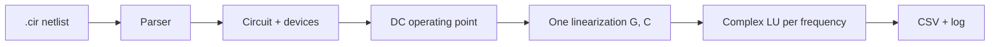
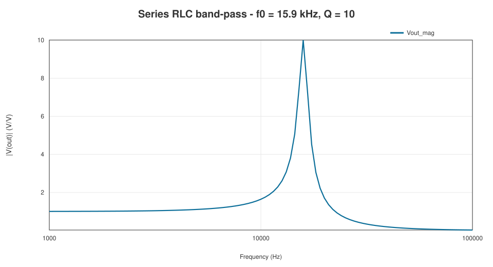
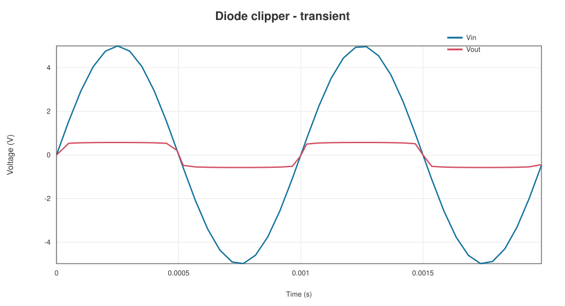
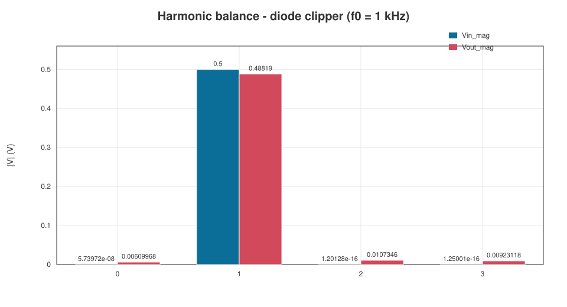
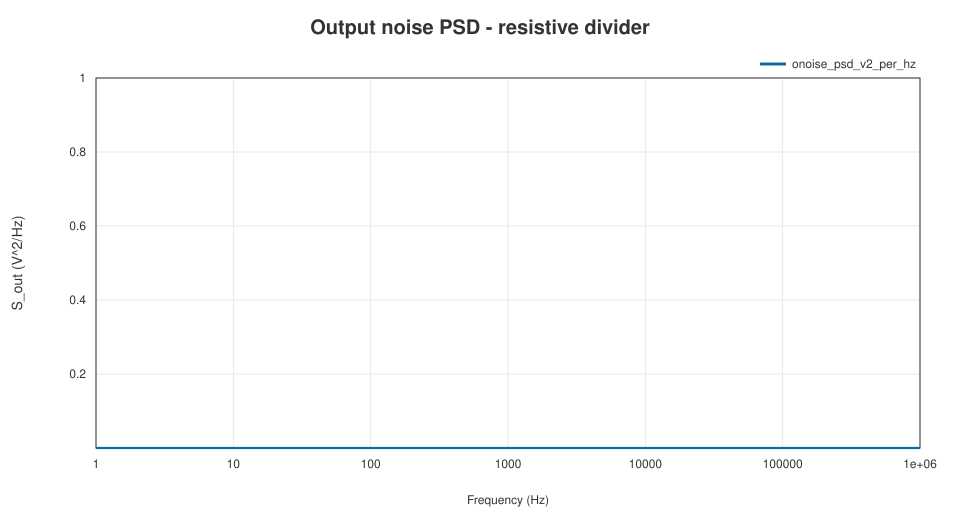
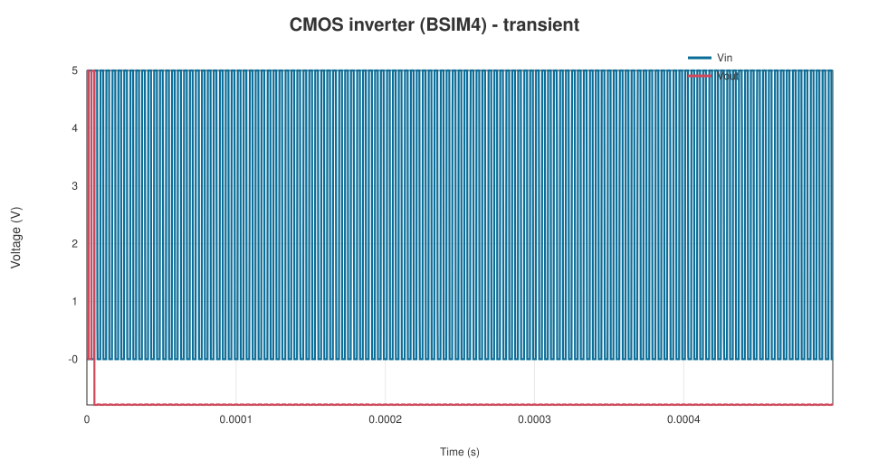
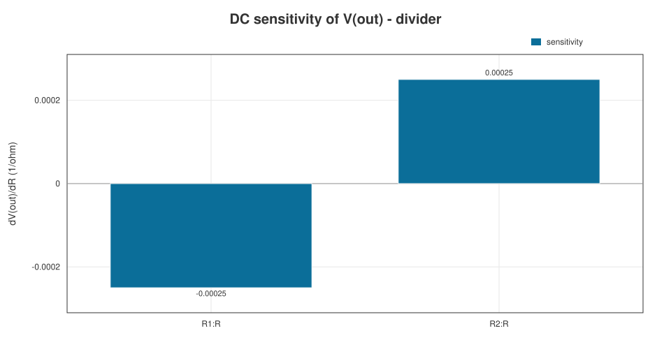
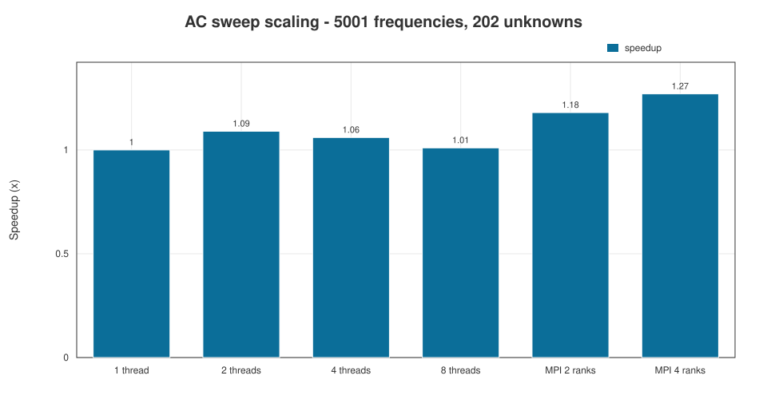

# e-XSpice: High-Performance Parallel Circuit Simulator


**e-XSpice** is an educational, yet highly scalable, electronic circuit simulator built from scratch in modern C++. Designed with High-Performance Computing (HPC) principles in mind, it utilizes a hybrid **MPI + OpenMP** parallelization strategy to accelerate the simulation of massive circuit netlists. 

This project explores the intersection of numerical analysis, sparse matrix computation, and distributed systems, providing a foundation for modern Electronic Design Automation (EDA) tools.

## Table of Contents
- [Showcase](#-showcase)
- [Core Features](#-core-features)
- [Mathematical Foundation (MNA)](#-mathematical-foundation-mna)
- [Software Architecture](#-software-architecture)
- [Building and Compilation](#-building-and-compilation)
- [Testing](#-testing)
- [Usage Examples](#-usage-examples)
- [Parallelization Strategy](#-parallelization-strategy)
- [Development Roadmap](#-development-roadmap)

---

## ✨ Showcase

Every result below comes from a real CLI run on a small netlist, checked
against a closed form whenever one exists. All of it is reproducible with
`./demos/run_demos.sh` (or `demos/run_demos.ps1`); each demo is also a CTest
case (`ctest -R Demo_`), so the showcase is verified in CI.

### Exactness against theory

| Quantity | Analysis | Theory | e-XSpice | Deviation |
|---|---|---|---|---|
| dV(out)/dR1 (divider) | `.SENS` | −2.5×10⁻⁴ | −2.500000000125×10⁻⁴ | 5×10⁻¹⁰ rel |
| dV(out)/dR2 (divider) | `.SENS` | +2.5×10⁻⁴ | +2.499999999875×10⁻⁴ | 5×10⁻¹⁰ rel |
| Worst \|H\| error, 101 frequencies | `.AC` | 1/(1+sRC+s²LC) | — | 1.5×10⁻¹⁵ rel |
| Worst phase error | `.AC` | — | — | 1.1×10⁻¹³ deg |
| Output noise PSD (divider) | `.NOISE` | 8.288035947×10⁻¹⁷ V²/Hz | 8.288035947×10⁻¹⁷ V²/Hz | <10⁻³¹ rel |
| Integrated output noise | `.NOISE` | 9.10386×10⁻⁶ V rms | 9.10386×10⁻⁶ V rms | — |
| RC step, worst sample error | `.TRAN` | 5·(1−e^(−t/RC)) | — | 2.5 mV (0.05 % FS) |

### The analyses, in figures



**Small-signal AC — series RLC band-pass** (`demos/ac_rlc_resonance.cir`)



Peak at f₀ = 15.9 kHz with |H| = Q = 10; worst deviation from
H(s) = 1/(1 + sRC + s²LC) over the sweep: 1.5×10⁻¹⁵.

**Transient — diode clipper** (`demos/clipper_tran.cir`)



**Harmonic balance — spectrum of the same nonlinearity** (`demos/hb_clipper.cir`)



Fundamental 0.488 V, 3rd harmonic 9.2 mV (1.9 % distortion).

**Noise — adjoint transfer with per-generator budget** (`demos/noise_divider.cir`)



**BSIM4 CMOS inverter** (`demos/bsim4_inverter.cir`)



**DC sensitivity of a divider** (`demos/sens_divider.cir`)



### Parallel frequency sweeps — and deterministic by construction

The dense AC ladder (`demos/ac_ladder_200_freqpar.cir`) solves **5001
frequencies** from a single linearization. Frequencies are independent, so
the sweep splits across OpenMP threads or MPI ranks (`.OPTIONS ACFREQPAR`),
and the CSV is **byte-identical** to the serial run for 1, 2 and 4 ranks.



Representative run on an Intel i5-9300HF (4 cores), CSV written to disk:

| Config | Time | Speedup |
|---|---|---|
| 1 thread | 6.46 s | 1.00× |
| 2 threads | 5.92 s | 1.09× |
| 4 threads | 6.09 s | 1.06× |
| 8 threads | 6.37 s | 1.01× |
| MPI 2 ranks | 5.46 s | 1.18× |
| MPI 4 ranks | 5.08 s | 1.27× |

The benchmark prints the SHA-256 of every CSV: for this workload the output is
**byte-identical between 1, 2 and 4 ranks** (the same guarantee the
`AC_Netlist_MPI` / `AC_Netlist_FreqPar` CTest cases pin). Timings move with
the CPU turbo/thermal state and the CSV/report path is single-threaded, so
small sweeps do not benefit from extra ranks — the automatic thresholds keep
the sequential path there. Reproduce with
`powershell -ExecutionPolicy Bypass -File demos/benchmark_scaling.ps1`.

---

## Core Features

### Numerical & Simulation Capabilities
- **SPICE Netlist Parser:** Native support for parsing `.cir` files — R/C/L, independent V/I sources (DC, PULSE, SIN, PWL and the `AC <mag> [phase]` small-signal spec), diodes with `.MODEL` cards (parameter expressions like `1k`, `100n`, `1u`), `IC=` initial conditions and `+` continuation lines. A source carries both specs independently, as in SPICE: `V1 in 0 DC 5 AC 1m 90` biases the node at 5 V and excites a 1 mV phasor at 90°, while `V1 in 0 AC 1` is a pure small-signal source (DC 0).
- **DAE formulation (Xyce-style):** the circuit is solved as the nonlinear DAE
  `C(x)·ẋ + F(x) = b(t)`. Every device contributes:
  - `F(x)` — static residual (Kirchhoff laws + constitutive laws),
  - `Q(x)` — charges/fluxes (capacitor `Q = C·V`, inductor `Φ = L·i_L`, junction charge),
  - `dF/dx` and `dQ/dx` — the two Jacobians; the **time integrator** (not the device)
    forms the effective system `J = dFdx + s·dQdx` with `s = 2/dt` (trapezoidal) or
    `1/dt` (backward Euler). No device contains companion-model or integration code.
- **Analysis types:**
  - **DC operating point (.OP)** with Newton-Raphson, GMIN homotopy stepping and
    per-junction GMIN for nonlinear devices;
  - **Transient (.TRAN)** with trapezoidal/backward-Euler integration,
    **LTE-controlled adaptive time stepping**, breakpoint clamping, initial-condition
    operating points (`IC=`), and local step rejection with state rollback;
  - **DC sweep (.DC)** in the Xyce subset — `[LIN|DEC|OCT]` over a source, a
    resistor or `TEMP`, with an optional second (inner) sweep specification:
    - one `DaeSystem` setup for the whole sweep (pattern, CSR slots, states and
      MPI plan built once) plus a warm-started continuation chain and a linear
      predictor, instead of one operating point per analysis;
    - source-step refinement (bisection) when a point fails, and
      `.OPTIONS NOFAIL` to keep sweeping past a non-convergence;
    - streamed CSV (full precision) with a decimated in-memory sample, so RAM
      stays O(nodes) on long sweeps;
    - `.OPTIONS SWEEPPAR` splits the sweep **points** across ranks (each rank
      keeps its own chain, points are exchanged in chunks). It pays off when
      the per-point solve is expensive (measured 1.5x on 4 ranks for a
      400-node diode ladder); for a handful of devices it loses to the
      sequential chain, which stays the default and bit-reproducible.
  - **Small-signal AC (.AC)** — `LIN|DEC|OCT` frequency sweep around the DC
    operating point, with per-source `AC <mag> [phase]` phasors (SPICE's dual
    spec, so one netlist carries both the bias and the excitation):
    - **one linearization for the whole sweep.** The frequency system is
      `(dF/dx + jω·dQ/dx)·X = B_ac`, and `dF/dx` / `dQ/dx` are exactly the two
      Jacobians the transient path already builds at the operating point, so
      devices need **no new physics hook** — only the excitation vector
      (`Device::loadACExcitation`). The device evaluation, the sparsity pattern
      and the symbolic factorization happen once; each frequency only refills
      the values (O(nnz)) and factorizes.
    - **native complex sparse LU** (`src/solver/ComplexSparseLU.{h,cpp}`)
      instead of Xyce's 2x2 real block form: half the factorization work and
      half the memory (4/3·N³ instead of 8/3·N³ real flops), split real/imag
      values (SoA, no `std::complex` temporaries), and a static fill-in pattern
      reused at every frequency.
    - **MNA-correct ordering:** the system is pivot-safe by construction — the
      ground node is eliminated (it is not an unknown), the node `gmin` is
      excluded (it is a DC convergence aid, not physics), and a static row
      permutation computed once from the first frequency's matrix gives every
      column a usable diagonal (MNA KCL rows of nodes wired only to
      sources/inductors have no self-term). An ideal source therefore pins its
      node **exactly** (measured: 2.000000000000000, 0°).
    - **frequencies run in parallel** — OpenMP across the sweep by default,
      and `.OPTIONS ACFREQPAR` splits them across MPI ranks in batched
      exchanges. Both are deterministic by construction: frequencies are
      independent and every rank factorizes the same replicated matrix, so a
      parallel run is **byte-identical** to the serial one (ctest checks it).
      Measured on a 401-unknown RC ladder with 501 frequencies: 4.24 s serial
      → 2.35 s with 4 OpenMP threads (1.8x) → 1.78 s with 4 ranks (2.4x,
      sub-linear because the operating point and the setup are replicated).
      On small circuits the sweep is not the bottleneck at all — for a
      401-unknown ladder the whole sweep is ~0.5 ms per frequency, so the
      operating point dominates and neither lever helps.
  - **Noise (`.NOISE`)** — output/input noise spectral densities and the
    integrated noise, sharing the `.AC` operating point and frequency engine
    (`src/analysis/NoiseAnalysis.{h,cpp}`):
    ```
    .NOISE V(out[,ref]) <src> (DEC|OCT|LIN) <pts> <fstart> <fstop> [pts_per_summary]
    ```
    (`src` may also be written `SRC=V1`, the Xyce spelling, and may be omitted
    — the first independent voltage source is then used).
    - **one adjoint solve per frequency serves every generator.** Each noise
      source is a Norton pair with a PSD known at the operating point, and its
      transfer to the output is a row of `A⁻¹`. Solving that per generator would
      cost one linear solve per generator per frequency; by symmetry of `A` a
      single transposed solve `Aᵀ·x* = e_out` yields **all** of them at once
      (`H_i = x*[pos] − x*[neg]`). Xyce does the same
      (`N_ANP_NOISE.C::solveAdjointNOISE_`), so the sweep cost scales with the
      circuit and not with `sources × unknowns`.
    - `ComplexSparseLU::solveTranspose()` does that with no extra factorization
      and no transposed copy of the factors: `Aᵀ = Uᵀ·Lᵀ` is solved as two
      triangular sweeps that read different halves of the compact column
      storage (`Uᵀ` above the split, `Lᵀ` below). Verified against a dense
      pivoted reference on the transposed matrix (residual ~1e-15).
    - **the generators are evaluated once**, at the operating point
      (`Device::loadNoiseSources`), as `S(f) = psd·f^(−NF)`: the sweep only
      applies the frequency factor, with no per-device call per frequency.
      Covered today: resistor thermal `4kT/R`, diode shot `2q·Id` (+ the series
      `RS` thermal noise), BJT shot `2q·Ic`/`2q·Ie` (+ `RB`/`RC`/`RE` thermal
      when the card creates the internal nodes), MOS level-1 channel thermal
      `(8/3)kT·gm`. Ideal C, L and sources are noiseless.
    - **the gain does not depend on the netlist's `AC` magnitudes.** The input
      source is driven with a *unit* phasor (SPICE convention), so `.NOISE`
      works even when `V1` carries no `AC` spec. It costs one forward solve on
      the factorization the adjoint solve already needed — and it cannot be
      taken from the adjoint vector by reciprocity, because the MNA matrix is
      not symmetric once the ground column is eliminated (measured: the
      reciprocal answer is off by the source's terminal resistance).
    - integrals follow SPICE3's `Nintegrate` (piecewise power law in log-log
      space, the same routine as Xyce's `noiseIntegral`), reported both in V²
      and as V rms — what a noise budget is quoted in.
    - **deterministic under parallelism**, like the AC sweep: frequencies are
      independent and the integral is a sum over the whole sweep. Measured on a
      401-generator resistor ladder (402 unknowns, 501 frequencies): 2.85 s
      serial → 1.59 s with 4 OpenMP threads (1.8×) → 1.73 s with 2 ranks →
      1.30 s with 4 ranks (2.2×), with the CSV **byte-identical** across all
      four (ctest checks it).
  - **Sensitivity (`.SENS`)** — `dO/dp` of an output expression with respect to
    circuit parameters, in the three flavours of the small-signal problem
    (`src/analysis/SensitivityAnalysis.{h,cpp}`,
    `src/analysis/ACSensitivityAnalysis.{h,cpp}`,
    `src/analysis/TransientSensitivityAnalysis.{h,cpp}`):
    ```
    .SENS        V(out) [R1,R2,...]              (DC)
    .SENS AC     V(out) [R1,R2,...]              (small signal)
    .SENS TRAN   V(out) [R1,R2,...]              (time domain)
    .SENS objfunc=V(out) param=R1,R2            (Xyce spelling)
    .SENS acobjfunc=V(out) param=R1,R2          (Xyce, AC)
    .SENS tranobjfunc=V(out) param=R1,R2        (Xyce, transient)
    ```
    - **one formulation for the three flavours.** The sensitivity is always the
      right-hand-side perturbation of the small-signal system,
      ```
      w = ∂B/∂p − (∂G/∂p)·X − s·(∂C/∂p)·X
      dO/dp = λᴴ·w          (λ = A⁻ᴴ·∂O/∂X)
      ```
      and `w` is produced by the device layer (`Device::loadSensitivity`), so
      the analysis engines are device-agnostic and a new device becomes
      differentiable by implementing that one hook. Because the device residual
      is linear in the unknowns, the device-level derivative IS the
      matrix-level one (`(∂G/∂p)·X = ∂F/∂p` evaluated at `X`).
    - **DC and AC use the adjoint** (`Aᵀ·λ = ∂O/∂X`, one solve per objective),
      so the cost of the sweep is independent of the number of parameters — the
      reason this engine never pays the direct method's `O(n_params·solve)`.
      Xyce offers both (`direct=1/0`); the scalable one is always used here.
      The AC sweep runs the frequencies concurrently over OpenMP (each thread
      owns its own LU and buffers, and the result does not depend on the
      grouping: the CSV is byte-identical for 1 and 4 threads).
    - **the transient uses the direct method with the recursion of the
      trajectory** (`Y_{n+1} = J⁻¹·(w + s·(dQ/dx)·Y_n)`), because the
      sensitivity of a time SERIES is the derivative of a recursion: the
      adjoint of a recursion is a backward sweep, which cannot produce the
      sensitivity of every time point of a forward simulation. One
      factorization per step is shared by all the parameters, and the
      perturbation is carried forward through the charge history (the term
      that makes the sensitivity of a capacitor charge depend on the whole
      trajectory, not only on the current step). The trapezoidal rule's
      secondary history (the stored `dQ/dt`) is differentiated too, so the
      result is the exact derivative of the integrated scheme.
    - **the trajectory is the one a plain `.TRAN` produces**: the sensitivity
      hooks into the transient engine's step observer, so the breakpoints, the
      step rejection and the LTE controller are shared (no re-implementation
      of the time loop).
    - covered parameters: `R` (resistor), `C` (capacitor), `L` (inductor),
      `DC`/`V` (voltage source), `DC`/`I` (current source). In the AC flavour
      the source parameter is the AC magnitude. Nonlinear devices (diode, BJT,
      MOSFET) are not differentiable yet: their residual is not linear in the
      unknowns, so the device-level derivative is not the matrix-level one.
    - verified against closed forms: `d(V(out))/dR1 = −V1·R2/(R1+R2)²` and
      `d(V(out))/dR2 = +V1·R1/(R1+R2)²` (DC divider), `dH/dR = −sC/(1+sRC)²`
      and `dH/dC = −sR/(1+sRC)²` (AC low-pass), and
      `dv/dR = −(t/R²C)·e^(−t/RC)`, `dv/dC = −(t/RC²)·e^(−t/RC)` (transient
      step). `tests/test_sens.cpp` checks them, plus the adjoint against a
      dense pivoted reference on a circuit whose pivot-safe ordering is not
      the identity.
  - **Harmonic Balance (`.HB`)** — the steady-state periodic response of a
    (nonlinear) circuit, in the frequency domain
    (`src/analysis/HBAnalysis.{h,cpp}`):
    ```
    .HB <fundamental frequency> [number of harmonics]
    .OPTIONS HBINT NUMFREQ=<n>          (the Xyce spelling of the same)
    ```
    - **one formulation, the same device contract.** The unknowns are the
      Fourier coefficients `X_k` of the MNA solution, and the equations are
      the Fourier coefficients of the residual:
      ```
      R_k = F_k + j·k·ω·Q_k − B_k = 0
      ```
      The devices are evaluated at the phase points of one period
      (`x(t_n) = Σ_m X_m·e^{jmωt_n}`) and the result is transformed back
      with a DFT. The Jacobian is the CONVOLUTION of the time-domain Jacobian
      with the DFT — the per-entry DFT of `dF/dx` is computed ONCE per
      Newton iteration and the blocks are read off it, so the cost is
      `O(nnz·N·K)` instead of the `O(nnz·N·K²)` a direct accumulation
      would cost.
    - **device-agnostic**: the HB reuses the very same device contract as the
      transient and the AC analyses (F, Q, B and the two Jacobians), so every
      device that works in the time domain works here — no per-device HB path
      and no device-specific restriction list.
    - the Newton limiting (PNJLIM) is a convergence aid of the time-domain
      solver and it CHANGES the residual, so the HB turns it off (Xyce has the
      same switch, `.OPTIONS HBINT VOLTLIM`).
    - **the initial guess does not need a transient run**: the operating point
      gives the DC harmonic and the AC solution at the fundamental gives the
      first one (Xyce's default is a full transient-assisted run, which costs
      a whole transient simulation just to seed the Newton). The step is
      damped when the plain Newton step overshoots, which is what keeps the
      iteration stable on a strongly nonlinear circuit.
    - the harmonic system is assembled on the DAE's FIXED sparsity pattern,
      so the symbolic factorization runs once and every Newton iteration only
      refills the values. The pivot-safe ordering is decided once, from the
      first matrix that is assembled.
    - the source is driven by its `AC` phasor when it has one (the
      frequency-domain convention) and by its time-domain waveform otherwise.
    - **limitations, documented and not silent**: single tone (the multi-tone
      case needs a non-commensurate sampling grid), and the Newton solve is a
      dense block solve, so the reachable problem size is the one a direct
      solver can take — the Krylov alternative for large systems is the
      natural next step.
    - verified two ways: against the AC analysis (a linear circuit must
      reproduce it exactly, and the higher harmonics must vanish) and against
      the TRANSIENT analysis (the harmonic balance spectrum must match the
      Fourier coefficients of the transient steady state).
- **Circuit temperature (`.TEMP <celsius>`, also `.OPTIONS TEMP=`):** re-scales
  every model card that did not pin its own `TEMP=` (SPICE precedence:
  instance > card > circuit) and refreshes the devices that precompute
  temperature scalars, e.g. resistor TC1/TC2. `TEMP` is also a valid `.DC` sweep
  variable, in which case the shared cards are re-scaled per point while the
  same DAE system keeps solving.
- **Robust nonlinear devices:** PN junction diode with the full SPICE3/Xyce level-1 model
  (Shockley + high-injection knee + reverse third-power law + breakdown + transit-time
  diffusion charge + C⁰-continuous junction capacitance + PNJLIM limiting + GMIN).
- **Fixed-sparsity-pattern assembly:** devices declare their Jacobian stamp once and
  write into pre-resolved CSR slots — no `std::map`/sorting per iteration, with
  device-parallel assembly (OpenMP) above a size threshold.
- **Solvers:** Jacobi-preconditioned BiCGSTAB (scalable) + dense-LU direct fallback
  (robustness), with automatic switch for small/medium systems.
- **HPC:** hybrid MPI + OpenMP architecture with parallel-size thresholds, so small
  circuits never pay parallel-region overhead.

---

## Mathematical Foundation (MNA)

e-XSpice relies on Modified Nodal Analysis (MNA) to formulate the circuit equations. The simulator constructs and solves the following sparse linear system:

$$\mathbf{G} \mathbf{x} = \mathbf{b}$$

Where:
* $$\mathbf{G}$$ is the Conductance/Incidence matrix.
* $$\mathbf{x}$$ is the vector of unknown node voltages and branch currents of voltage-defined devices.
* $$\mathbf{b}$$ is the vector of known independent source values.

For Transient Analysis, the companion model approach is used, transforming differential equations of dynamic components ($C$, $L$) into equivalent discrete-time resistive circuits for each time step.

---

## Software Architecture

```text
e-XSpice/
├── src/
│   ├── core/           # Circuit topology, Node, Device (DAE contract), parser
│   ├── devices/        # Device instances (R, C, L, V/I sources, diode, BJT, waveforms)
│   ├── models/
│   │   ├── core/       # Model SYSTEM: DeviceModel, ModelCard, ModelRegistry
│   │   └── core_models/# Model MATH: Diode, Bjt, passives, shared Junction physics
│   ├── analysis/       # DaeSystem (DAE/NR core), DCAnalysis, DCSweep,
│   │                   #   TransientAnalysis, ACAnalysis (small-signal),
│   │                   #   NoiseAnalysis, SmallSignalLinearization (shared
│   │                   #   OP + (G,C) + ordering for both frequency engines)
│   ├── solver/         # DaeMatrix (fixed pattern), StateStore, LinearSolver,
│   │                   #   ComplexSparseLU (AC/noise factorization + adjoint)
│   ├── parallel/       # MPI communicator wrappers and OpenMP pragmas
│   └── main.cpp        # CLI entry point
├── tests/              # CTest suite, incl. analytical physics verification
├── demos/              # Runnable showcase circuits (+ CTest smoke cases),
│                       #   run_demos scripts and README figures (SVG)
├── examples/           # Benchmark circuits and .cir netlists
├── tools/              # csv2svg: dependency-free CSV -> SVG plotter
└── CMakeLists.txt      # Main CMake configuration
---
```

### The DAE device contract

```
                 ┌──────────────────────────────┐
   netlist ─────▶│  Parser → Circuit → Devices  │
                 └──────────────┬───────────────┘
                                │  setup(): pattern + indices + states
                 ┌──────────────▼───────────────┐
                 │        DaeSystem             │
                 │  F, Q, B, dFdx, dQdx load    │
                 │  J = dFdx + s·dQdx           │
                 │  Newton + gmin homotopy      │
                 │  LTE step control (transient)│
                 └──────────────────────────────┘
```

Every device implements five setup methods (`numExtraUnknowns`,
`registerJacobianPattern`, `setJacobianSlots`, `registerStates`, `setTopology`) and
seven evaluation methods (`loadF`, `loadQ`, `loadB`, `loadJacobianF`, `loadJacobianQ`,
`storeState`, `loadACExcitation` + `loadNoiseSources`). Adding a device (JFET,
IGBT, …) means implementing those — no analysis code needs to change.

### The AC path: one linearization, many frequencies

```text
  .AC DEC 10 10 1Meg
      │
      ▼
  DaeSystem.solveNonlinear()      ← ONE operating point
      │
      ▼
  refreshLinearization()          ← dF/dx and dQ/dx AT that point (not the
      │                            previous Newton iterate)
      ▼
  (G, C) = (dF/dx, dQ/dx)         ← one snapshot, both on the same CSR pattern
      │
      ├── ground row/column eliminated  (x(gnd) = 0 is not an unknown)
      ├── node gmin excluded            (DC homotopy aid, not physics)
      ├── pivot-safe row permutation    (computed once, from the first ω)
      ▼
  ComplexSparseLU:  symbolic once ──▶ per frequency:  factorize(G + jωC) + solve
      │
      ▼
  |X|, arg(X) per node  +  |I|, arg(I) per branch unknown
```

Because `dF/dx` and `dQ/dx` are the *transient* Jacobians, a device supports AC
the moment it supports transient: the only addition to the device contract is
`loadACExcitation` (the phasor on the right-hand side, split into real and
imaginary vectors so the device layer stays free of `<complex>`). A resistor,
a MOSFET and a BSIM4 device need no AC code at all.

### The noise path: the same factorization, one transposed solve

```text
  .NOISE V(out) V1 DEC 20 10 1Meg 1
      │
      ▼
  shared SmallSignalLinearization (OP + (G, C) + ordering — the AC path, verbatim)
      │
      ▼
  Device::loadNoiseSources()  ← ONCE, at the operating point: every generator
      │                           reports (pos, neg, S(1 Hz), NF)
      ▼
  per frequency:
      factorize(G + jωC)                ← static pattern, symbolic already done
      solveTranspose(e_out)             ← x* : ONE solve for ALL generators
      per generator: |x*[pos] - x*[neg]|² · S(f)
      forward solve with the unit phasor of the input source  ← the gain
      │
      ▼
  S_out, S_in, and SPICE's Nintegrate over the band (per generator and total)
```

The transposed solve is what makes this affordable: `H_i = e_outᵀ A⁻¹ e_i` is one
component of `x*`, so a circuit with 401 generators costs exactly the same per
frequency as one with 1. The generators themselves are computed once at the
operating point (`S(f) = psd·f^(−NF)` covers thermal, shot and flicker), so the
sweep does no per-device work at all.

### The model layer (`src/models/`)

Following Xyce's `DeviceModelPKG` — but with the temperature math hoisted out
of the per-instance path — every device is agnostic to its model contents:

```
.MODEL DMOD D (IS=1e-14 N=1.0 ...)     netlist card
        │  generic ModelCard (no physics in the parser)
        ▼
ModelRegistry ──factory──▶ DiodeModel ──shared──▶ D1, D2, ... (RCP)
   (D/R/C/L/NPN/PNP/      (validates once, scales to TEMP once;
    NMOS/PMOS built-in;     instances read via pointer, zero loop cost)
    new type = 1 line)
```

- `DeviceModel`: abstract card (name, type letter, `processParams`, `updateTemperature`) **plus the declarative parameter table** (`declareParams` + `applyCardParams`, Xyce-`addPar`-style): each subclass lists its keys once — `makeParam` (canonical), `makeAlias` (SPICE spelling, canonical wins on conflict), `makeCelsiusParam` (`TNOM`/`TEMP` arrive °C, stored K), `makeIntParam` (`LEVEL`) — with one-line help each.
- `ModelRegistry`: owns cards by name; factories only construct defaults (one-line lambdas, never parse); the registry fills card values **generically** from the table, rejects unknown keys with the valid list (`... unknown parameter(s) 'BTEA' (valid parameters: IS N RS ...)`), and lists registered types on unknown `.MODEL` types. Typed checked lookup (`findAs<T>`).
- Adding a model = subclass + table + `processParams()` + one factory line. No parser change, no `fromCard` loop, no forgotten alias, no silent typo.
- Instance lines use the SAME machinery: each `*InstanceParams` struct
  declares its own option table (`AREA`/`M`/`W`/`L`/`TEMP`… with the
  `TEMPGiven` hook), and one generic `parseInstanceTail` fills it —
  unknown options fail with the valid list (a misspelled `AREA=` used to
  be silently ignored). New instance options never touch parser code.
- `DiodeModel`: full level-1 physics + one `DiodeThermal` snapshot per card (bandgap `VJ(T)`/`CJO(T)`, `IS(T)`, `tVcrit`, breakdown fit, `F2/F3/tF1` continuity constants). Instances keep only `AREA`/`M`/`TEMP` overrides — an instance-level `TEMP` gets its own snapshot, otherwise it reads the card's. `BV`/`VB` set `BVGiven` via the `onParamGiven` hook.
- `BjtModel`: **level 1 (Ebers-Moll transport) + level 2 (Gummel-Poon), NPN *and* PNP from one polarity-agnostic card** — `LEVEL`, `IS/BF/BR/NF/NR`, base-width modulation (`VAF`/`VAR`), transit time `TF`/`TR`, per-junction depletion capacitance (`CJE/VJE/MJE`, `CJC/VJC/MJC`), `IS(T)` per junction, `gmin`; level 2 adds the normalized base charge `qb` (high injection via `IKF/IKR`), non-ideal base currents (`ISE/NE`, `ISC/NC`), ohmic `RB/RC/RE` (internal nodes, zero-cost when absent), and the substrate diode + `CJS/VJS/MJS` (optional 4th terminal). With all GP extras off, level 2 reduces to level 1 (`qb → q1 = 1/K_E`). See `Bjt.h` for the complete derivation and stamping.
- `MosfetModel`: **level 1 (Shichman-Hodges), NMOS *and* PMOS from one polarity-agnostic card** — `VTO/KP/LAMBDA/PHI/GAMMA` (VTO follows the SPICE sign, negative for PMOS), bulk `IS/PB/MJ/FC` + `CBD/CBS`, overlap `CGSO/CGDO/CGBO`, `TOX/LD` (effective `BETA = KP·W/Leff`, `Cox = εox/TOX·W·Leff`), `IS(T)/PHI(T)/PB(T)`. Instances carry `W/L/M/AD/AS/TEMP`.
- `PassiveModels`: `ResistorModel` (`R` multiplier + `TC1`/`TC2`, wired: `R1 1 2 RMOD 1k`), `CapacitorModel`/`InductorModel` ready for the same path.
- `Junction.h`: the PN-junction math **shared by diode, BJT and MOSFET bulk** — `Q(V)`/`C(V)` C⁰-continuous at `FC·VJ`, the bandgap temperature scaling and `IS(T)`. Header-only and `inline`: every device inlines it into `loadF`/`loadQ`, one source of truth, zero call overhead.
- Parser dispatch is data-driven: device letters go through a creator map, model types through the registry — a new device needs no parser-core changes.

### The BJTs (`src/devices/Bjt.{h,cpp}`)

```
Q<name>  <collector> <base> <emitter> [substrate]  <NPN|PNP card>
         [AREA=<a>] [TEMP=<degC>]
```

* Level 1: three terminals, no internal nodes; one code path for both
  polarities (the device remaps the junction voltages, the card stays
  polarity-agnostic, and **every intrinsic Jacobian entry is identical for
  NPN and PNP** — verified by the mirror tests, which compare all terminal
  values bit-for-bit).
* Terminal currents: `i_b = I_BE + I_BC`, `i_c = I_CT − I_BC`, `i_e = −i_b − i_c`;
  charges: `Q_BE = dep(vbe) + τF·i_c`, `Q_BC = dep(vbc) − τR·i_c` — including
  the transit-charge cross derivatives, so Newton keeps quadratic convergence.
* Level 2 (`LEVEL=2`): Gummel-Poon — transport current divided by `qb`,
  non-ideal base currents, `RB/RC/RE` via internal unknowns (same
  extra-unknown range mechanism as the diode's `Pri` node; zero unknowns
  when the resistances are zero), optional substrate terminal with its own
  diode + charge + state. Frame rule for polarity: intrinsic laws are
  N-oriented (p² = 1, polarity-free Jacobian), ohmic drops stay physical
  (no `p` anywhere) — mixing the frames negates the PNP equation.
* Robustness: SPICE3f5 PNJLIM on **both** junctions, and the limiting
  write-back (`applySolutionLimit`) that restarts the Newton iteration at the
  limited point — without it a current-source-driven junction (no resistive
  path) never converges. The diode uses the same hook.

### The MOSFETs (`src/devices/Mosfet.{h,cpp}`)

```
M<name>  <drain> <gate> <source> <bulk>  <NMOS|PMOS card>
         [W=<w>] [L=<l>] [M=<m>] [AD=<a>] [AS=<a>] [TEMP=<degC>]
```

* Level 1 Shichman-Hodges, one polarity-agnostic code path (same `p`
  remapping trick as the BJT; `VTO` keeps the SPICE sign, `GAMMA/PHI`
  stay positive — reverse bulk bias is negative in the N-oriented frame
  for both). Source/drain swap internally when `vds < 0`, mapping
  currents, derivatives and Meyer caps back to the physical frame, so a
  single unified 4×4 stamp serves all quadrants.
* Channel `Id/gm/gds/gmbs` with exact region derivatives, always-on bulk
  diodes (`IS + gmin`), Meyer partition (`Cox/2` linear, `2Cox/3`
  saturation, `Cox` cutoff) + overlap + bulk depletion in one
  charge-conserving stamp (`Qs = −Qg−Qd−Qb`, three states).
* Limiting: PNJLIM on both bulk diodes + bounded-step clamp on the channel
  (quadratic needs no exponential limiter), gate-anchored write-back
  (never fights a voltage-driven gate).

### Newton limiting (write-back)

SPICE/Xyce semantics, now shared by every nonlinear device: an iteration that
a device rejects (`acceptSolution() == false`) is followed by the device
writing its **limited unknowns back into the solution vector**, so the next
iteration starts from the limited point instead of walking the exponential up
by `Vt` per iteration. Serial path only (the distributed path must keep `x`
identical on every rank). Two refinements over the textbook hook: the
write-back shifts external + internal terminals together (preserving every
ohmic drop — otherwise it fabricates kiloamp residuals into nearly singular
base blocks), and each device re-anchors its limiter history from raw values
(`resetIterationState`) whenever the solver restores a sane point, so a
poisoned history can never misfire `pnjlim` on a retry.

### Newton core hardening (`src/analysis/DaeSystem.{h,cpp}`)

* **Direct LU for small systems** (≤ 2000 rows): Krylov on a nearly singular
  Newton Jacobian can "converge" with arbitrary nullspace components while LU
  returns the deterministic answer — and is cheaper than up-to-2000 Krylov
  iterations per Newton step. Krylov stays the workhorse above that size.
* **Residual convergence test**: `|Δx|`-small no longer suffices — with a
  singular Jacobian it coexists with a big residual. Acceptance now also
  requires the freshly reassembled residual small against the equation scale
  (one extra assembly per solve), plus a re-check that no limiter fired.
* **Adaptive trust region** (node voltages only; branch currents are
  Lagrange multipliers and must stay free): grows ×2 on residual progress,
  shrinks ×0.5 on growth, between 1e-3 V and 100 V. Lets kilovolt circuits
  step freely while herding floating-node excursions down.
* **GMIN homotopy from the sane point**: a failed direct Newton restores the
  pre-attempt point (not its own diverged garbage) before stepping `gmin`
  down — homotopy then tracks the physical branch instead of a parasitic one.
* **DC warm start**: `DCAnalysis::run(use_initial_guess=true)` now honors
  its flag (previously ignored), seeding Newton with the previous solution
  for honest continuation sweeps past bistabilities.

## Building and Compilation 

The project uses a modern **CMake workflow**, ensuring a seamless and unified build process across **Windows, Linux, and macOS**.

### 1. Prerequisites

- C++17 compatible compiler (**MSVC, GCC, or MinGW**)
- **CMake 3.15+**
- **MPI Implementation:**
  - **Windows:** MS-MPI (install both `msmpisetup.exe` and `msmpisdk.msi`)
  - **Linux:** OpenMPI or MPICH
- **OpenMP** (usually bundled with modern C++ compilers)

---

### Cross-Platform Compilation

Open your terminal (or Developer Command Prompt / PowerShell on Windows) and run:

### Clone the repository
```text
git clone [https://github.com/Gabriel-H-R/e-XSpice.git](https://github.com/Gabriel-H-R/e-XSpice.git)
cd e-XSpice
```

### Compilation Details

 Windows (Using MinGW / Git Bash)

Ensure your MinGW compiler and MS-MPI paths are properly configured in your system's `PATH`

```text
# Generate build files for MinGW
cmake -S . -B build -G "MinGW Makefiles"

# Compile using multiple CPU cores
cmake --build build --config Release -j
```

 Linux (Ubuntu / Debian)

Install the required dependencies:


```text
sudo apt-get update
sudo apt-get install cmake build-essential libopenmpi-dev openmpi-bin
```

Compile the project:

```text
# Generate standard Unix Makefiles
cmake -S . -B build -DCMAKE_BUILD_TYPE=Release

# Compile using all available cores
cmake --build build -j $(nproc)
```
---

## Testing

e-XSpice includes a suite of automated unit tests to validate the physical accuracy of the solvers against expected SPICE results. To run the tests using **CTest**:

```text
cd build
ctest --output-on-failure
```

## Usage Examples

In the `examples/` folder, you will find some benchmark circuits and `.cir` netlists. After compilation, the executable will be located in the `build/` directory (`e-XSpice` on Linux/macOS, `e-XSpice.exe` on Windows).

### Mode 1: Simulating Custom Netlists (.cir)

You can run a custom SPICE netlist by passing the `file` argument:

```text
# Running an RC Step Response (Transient Analysis)
./build/e-XSpice file ./examples/rc_step.cir

# Running a Multi-loop Resistor Network (DC Analysis)
./build/e-XSpice file ./examples/multiloop.cir

# Small-signal frequency response of an RC low-pass (AC analysis)
./build/e-XSpice file ./tests/ac_rc_netlist.cir out.csv

# Sensitivity of an output to circuit parameters (DC, AC or transient)
./build/e-XSpice file ./tests/sens_dc_netlist.cir sens.csv
./build/e-XSpice file ./tests/sens_ac_netlist.cir sens.csv
./build/e-XSpice file ./tests/sens_tran_netlist.cir sens.csv
```

An AC netlist only needs the excitation and the sweep:

```spice
* RC low-pass: |H| = 1/sqrt(1+(wRC)^2), phase = -atan(wRC)
V1 in 0 DC 0 AC 1
R1 in out 1k
C1 out 0 1n
.AC DEC 10 10 1Meg
.END
```

```text
$ ./build/e-XSpice file ac_rc.cir ac_rc.csv
[ACAnalysis] DEC sweep 51 frequencies, 10 Hz .. 1e+06 Hz
[ACAnalysis] operating point in 1 Newton iterations
AC sweep: 51/51 frequencies (last 1e+06 Hz)
AC analysis completed: 51 frequencies (DEC), 3 unknowns, peak of |Vout| = ...
  OP iterations: 1 | factorizations: 51 | LU flops: 485316 | ranks: 1 | time: 0.0006 s
  Peaks (of the sampled grid — a very high-Q resonance can be narrower than the
  frequency step):
    |Vin|_max = 1 (0 dB) at 10 Hz
    |Vout|_max = 1 (0 dB) at 10 Hz

Magnitude / phase (linear and dB):
  f=10 Hz: |Vin|=1 (0 dB) @0deg |Vout|=1 (0 dB) @-0.0036deg |I|=6.28e-08 (-124 dB) @-90deg
  ...
  f=100000 Hz: |Vin|=1 (0 dB) @0deg |Vout|=0.846733 (-1.44 dB) @-32.1419deg |I|=0.000532 (-65.5 dB) @-122.14deg
```

The log prints **decibels next to the linear magnitude** because a frequency
response is read in dB: 0 dB is the input level, a roll-off shows as negative
dB, and a resonance as a positive bump — in linear units both just "decay
towards zero" and it is impossible to tell whether the response ever crossed
unity. The peak line reports, per node, the largest magnitude found **over the
whole sweep** (not the decimated log sample) and where it occurs. Keep in mind
that it is the peak **of the sampled grid**: a resonance narrower than the
frequency step (`Q = 1e6` is a 0.16 Hz bandwidth at 159 kHz, while `DEC
100/decade` steps 3.7 kHz there) shows up as the grid point nearest `f0`, not
as `Q` — the same in every simulator.

The CSV carries `frequency`, then `<node>_mag` / `<node>_phase` per node and
`<device>_imag_mag` / `<device>_imag_phase` per branch unknown (`I(V1)`, `I(L1)`).

A noise netlist reuses the same devices and the same operating point:

```spice
* Resistive divider: exact closed form, S_out = (R1||R2)^2·4kT·(1/R1 + 1/R2)
V1 in 0 DC 1
R1 in out 10k
R2 out 0 10k
.NOISE V(out) V1 DEC 10 1 1e6 1     <- pts_per_summary = 1 -> per-source columns
.END
```

```text
$ ./build/e-XSpice file noise_divider.cir noise_divider.csv
Noise analysis completed: 61 frequencies (DEC), 3 unknowns, 2 noise source(s),
  output noise 9.10386e-06 V rms, input noise 1.82077e-05 V rms
  OP iterations: 2 | factorizations: 61 | LU flops: 1830 | ranks: 1 | time: 0.0032 s

Integrated noise over the swept band:
  Output  V(out) = 9.10386e-06 V rms  (8.28803e-11 V^2)
  Input   referred to V1   = 1.82077e-05 V rms  (3.31521e-10 V^2)
  Peak of the output PSD = 9.10387e-09 V/sqrt(Hz) at 1 Hz

Noise sources (integrated output contribution):
  R1 (thermal): 6.4374e-06 V rms, 50%
  R2 (thermal): 6.4374e-06 V rms, 50%

Noise spectral density (V/sqrt(Hz)):
  f=1 Hz: onoise=9.10387e-09 inoise=1.82077e-08 |gain|=0.5
  ...
```

Checkable against theory: `S_out = (R1‖R2)²·4kT·(1/R1 + 1/R2) = 8.2875e-17 V²/Hz`
and `S_in = S_out/gain² = 4kT·(R1+R2) = 3.3151e-16 V²/Hz` — the textbook
equivalent input noise of a resistive divider.

The log leads with the **integrated** numbers (V rms over the band), which is
what a noise budget is quoted in, then ranks the generators by contribution —
that ranking is the answer to "what do I fix first". The CSV carries the power
spectral densities in V²/Hz, `gain_mag`, `gain_phase_deg` and, with
`pts_per_summary`, one column per generator.

### Mode 2: Programmatic Examples & MPI

The simulator also contains hardcoded examples for scalability testing.

**Serial Execution**

```text
./build/e-XSpice 1
```

**Distributed MPI Execution (setting 4 processes and 1k resistors)**

```text
mpiexec -np 4 ./build/e-XSpice 3 1000
```

Note:

On Linux, you may use `mpirun` instead of `mpiexec`
On Windows (MS-MPI), always use `mpiexec`

### OpenMP Thread Control

You can control the shared-memory parallelism by setting the `OMP_NUM_THREADS` environment variable before execution.

Windows (PowerShell)

```text
$env:OMP_NUM_THREADS="4"
mpiexec -np 2 ./build/e-xspice 3 10000
```

Linux (Bash)

```text
export OMP_NUM_THREADS=4
mpiexec -np 2 ./build/e-xspice 3 10000
```

---

## Parallelization Strategy

The simulator runs in **SPMD mode**: every rank builds the same circuit and
holds row-replicated assembly buffers plus the fixed sparsity pattern. Work
— not data — is partitioned (see `src/parallel/Distribution.h`):

### MPI (Distributed Memory)

- **Device-partitioned assembly:** each rank evaluates a disjoint device
  subset (greedy longest-processing-time assignment weighted by device cost:
  diodes/modal devices cost more than passives) into local `F/Q/B/J`
  buffers, fused by one SUM `Allreduce` per buffer per Newton iteration
  (`F/Q/B` travel packed in a single round trip). Active above 64 devices
  by default (configurable via `DaeSystem::setDistributionThresholds`).
- **Row-distributed Krylov solve:** each rank owns a contiguous row block;
  the solution stays replicated (Newton updates are identical everywhere),
  so a matvec needs only one `Allgatherv` of the locally computed block
  plus `Allreduce`d dots — no ghost exchange, no distributed matrix.
  Active above 20000 unknowns by default (configurable); below that the
  replicated Krylov + direct-LU fallback runs redundantly (cheaper than
  the collectives).
- **Identical control flow:** Newton/LTE/dt decisions derive only from
  globally synchronized quantities (limiter votes use one `AND`), so every
  rank takes the same branches with no extra coordination. Verified by the
  `MPI_Ladder_*` equivalence tests (serial vs 2/4-rank bit-level agreement).

### OpenMP (Shared Memory)

- Parallelizes device assembly and SpMV within each MPI rank (serial fast
  paths below size thresholds, so small circuits never pay region overhead).

### Tuning

```text
# Keep total threads ≈ core count (ranks × threads ≤ cores):
mpiexec -n 4 ./build/e-XSpice file examples/clipper_2000.cir   # + OMP_NUM_THREADS=2

# Force distribution on/off regardless of thresholds (tests, debugging):
EXSPICE_DISTRIBUTE=1  # force on     EXSPICE_DISTRIBUTE=0  # force serial

# Per-analysis traces (stderr):
EXSPICE_DEBUG_AC=1      # AC sweep internals
EXSPICE_DEBUG_NOISE=1   # noise sweep internals
EXSPICE_DEBUG_TF=1      # transfer-function internals
EXSPICE_DEBUG_LU=1      # sparse LU pivots
EXSPICE_DEBUG_SENS=1    # transient sensitivity, one line per accepted step
```

Rule of thumb: MPI distribution pays off for device-heavy circuits (costly
model evaluations amortize the ~5 collectives per Newton iteration) and for
very large systems via the distributed solve; on a single shared-memory box
with small/medium linear circuits, serial or pure OpenMP is often faster —
the thresholds encode exactly that trade-off. Demo circuits:
`examples/ladder_200.cir` (linear), `examples/clipper_500.cir` and
`examples/clipper_2000.cir` (nonlinear diode ladders).

For `.AC` the two levers are different in kind, and they multiply into
oversubscription if you use both blindly:

```text
# Default: every rank solves the whole sweep, OMP threads split the FREQUENCIES
OMP_NUM_THREADS=4 ./build/e-XSpice file ac.cir          # 1.8x on 4 threads

# `.OPTIONS ACFREQPAR`: ranks split the frequencies; keep OMP=1 to avoid
# oversubscription (measured 4 ranks x 4 threads = slower than either alone)
mpiexec -n 4 ./build/e-XSpice file ac_freqpar.cir       # 2.4x on 4 ranks
```

Both are exact: the CSV of a parallel run is byte-identical to the serial one,
which the CTest suite checks (`AC_Netlist_MPI`, `AC_Netlist_FreqPar`).


## Next Steps (Development Roadmap)
 - [x] Non-linear devices (Diodes + Newton-Raphson): PNJ + GMIN + PNJLIM + junction charge
 - [x] DeviceModel package (registry + factories, shared D/R/C/L cards, instance overrides)
 - [x] **Transistors NPN + PNP level 1** (Ebers-Moll transport: Early + transit time + per-junction capacitance, one polarity-agnostic code path)
 - [x] **Transistors NPN + PNP level 2** (Gummel-Poon: qb high injection, ISE/ISC non-ideal base, RB/RC/RE internal nodes, substrate terminal)
 - [x] **MOSFETs NMOS + PMOS level 1** (Shichman-Hodges + Meyer charges, symmetric vds<0 handling, one polarity-agnostic code path)
 - [x] SPICE-style limiting write-back (`applySolutionLimit`) for robust current-source-driven junctions
 - [x] Newton core hardening (direct LU ≤2000 rows, residual convergence test, adaptive trust region, sane-point homotopy restart, limiter-history reset, DC warm start)
 - [ ] Diode level-2 / sidewall junction (JSW, CJSW, VJSW)
 - [ ] BJT level-3 extras (base-resistance modulation RBM/IRB, excess phase PTF for AC, avalanche BV/IBV)
 - [ ] MOSFET level-2/3 (short-channel VMAX/THETA, subthreshold NFS, RD/RS/RG ohmic)
  - [x] **AC analysis (frequency domain) in the DAE framework** - one operating point
        and one linearization per sweep, native complex sparse LU with a static
        fill-in pattern, MNA-correct pivot-safe ordering, frequencies parallel
        over OpenMP/MPI with byte-identical results
  - [x] **Noise analysis (`.NOISE`)** - shared operating point and frequency
        engine, one transposed (adjoint) solve per frequency for every noise
        generator, SPICE3 integral, per-generator breakdown, parallel with
        byte-identical results
  - [x] **DC transfer function (`.TF`)** - DC small-signal gain, input and
        output resistance from a single linearization at the operating point
        (two solves on the shared complex LU, the input driven with a unit
        phasor); `V(node)`, `V(n1,n2)` and `I(dev)` output variables
  - [x] **Pole-zero (`.PZ`)** - poles and zeros of the small-signal transfer
        function via a grid search + bisection on `det(G + sC)` (and the
        augmented system for `vol` mode), with the DC gain; real poles and
        zeros are found, complex ones (underdamped systems) and zeros at
        `s = 0` are not yet covered
  - [ ] Noise extras: flicker noise in the level-1 MOS card (`KF`/`AF`/`NF`) and
        the BSIM4 unified flicker model (`EF`), correlated BJT noise (`T0/T2/T3`),
        `DATA=` table sweeps
  - [x] **Sensitivity analysis (`.SENS`)** - one formulation for the three
        flavours: the device layer produces the right-hand-side perturbation
        `w = ∂B/∂p − (∂G/∂p)·X − s·(∂C/∂p)·X` and the analysis only has to
        solve one adjoint system (DC, AC) or propagate the sensitivity
        recursion (transient). DC: one solve per objective regardless of the
        number of parameters. AC: the same adjoint over the frequency sweep.
        Transient: the direct method with the recursion of the trajectory
        (one factorization per step, shared by all the parameters), hooked into
        the transient engine's step observer so the trajectory is the one a
        plain `.TRAN` produces. Analytical d(F-B)/dp for R/C/L and V/I sources
  - [ ] Sensitivity extras: nonlinear device parameters (diode, BJT, MOSFET),
        `objfunc=` expressions, adjoint backward sweep for a single objective
        at the end of a transient
  - [ ] AC extras (`.PRINT`/`.PLOT` column selection)
  - [ ] `.TF` extras (output resistance for `I(dev)` outputs is reported as a
        magnitude; the sign convention for active devices is documented)
  - [ ] `.PZ` extras: complex poles/zeros (underdamped RLC) via a 2D search or
        an eigenvalue solver (QZ), zeros at `s = 0`, `.PRINT`/`.PLOT` support
  - [x] MOSFET BSIM4 model (level 14, Berkeley-derived level-2 core)
  - [x] **Pole-zero analysis (`.PZ`)** - real poles and zeros of the
        small-signal transfer function via grid search + bisection, DC gain,
        shared operating point and linearization
  - [x] **Harmonic balance (`.HB`)** - the steady-state periodic response in
        the frequency domain: the Fourier coefficients of the MNA solution are
        the unknowns, the devices are evaluated at the phase points of one
        period and transformed back with a DFT, the Newton step is damped, and
        the initial guess comes from the operating point plus the AC solution
        at the fundamental (no transient-assisted run). Device-agnostic (the
        same DAE contract as the transient and the AC analyses). Single tone;
        the dense block solve limits the problem size
  - [ ] HB extras: multi-tone (the intermodulation products need a
        non-commensurate sampling grid), a Krylov solve of the expanded
        harmonic system for large problems, `.PRINT HB` column selection
  - [ ] Preconditioning (ILU)
  - [ ] Graph partitioning (METIS) - and, for the AC path, a row-distributed
        complex LU with coordinated pivoting for million-unknown systems
 - [x] Distributed (MPI) assembly + solve (device-partitioned Allreduce fusion + row-distributed BiCGSTAB)


### License

This project is licensed under the GPL-3.0 License.
See the ```LICENSE``` file for details.

## References

### Core Resources
- [SPICE (UC Berkeley)](https://people.eecs.berkeley.edu/~newton/spice/)
- [ngspice](https://ngspice.sourceforge.io)
- [Xyce Parallel Electronic Simulator](https://xyce.sandia.gov/)

### Books (Circuit Simulation & SPICE)
- Vladimirescu, A. — *The SPICE Book* (McGraw-Hill, 1994)  
- Najm, F. N. — *Circuit Simulation* (Wiley-IEEE Press, 2010) 
- Tuma, T., Burmen, Á. — *Circuit Simulation with SPICE OPUS: Theory and Practice* (Birkhäuser, 2009)

### Books (Numerical Methods & Advanced Simulation)
- Benner, P., Hinze, M., ter Maten, E. — *Model Reduction for Circuit Simulation* (Springer, 2011) 

### High Performance Computing (HPC) 
- Hager, G., Wellein, G. — *Introduction to High Performance Computing for Scientists and Engineers* (CRC Press, 2010)
